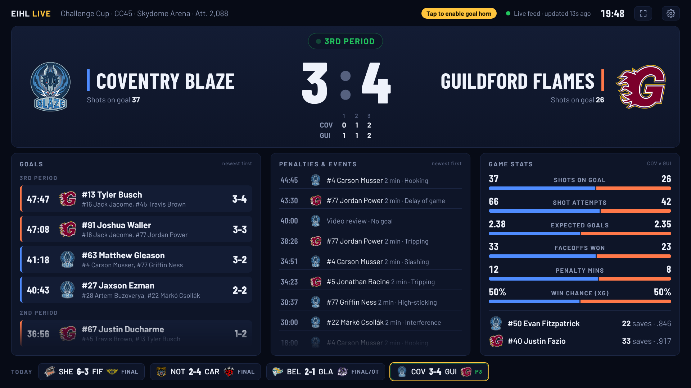

# EIHL Live

A full-screen live scoreboard for the Elite Ice Hockey League, made for a TV or tablet at home. It is one HTML file with no server and no build step.



It shows:

- the score, the period, the score by period and shots on goal
- every goal (scorer, assists, PP/SH/EN) and every penalty, newest first
- shots, shot attempts, expected goals, faceoffs, penalty minutes, xG win chance, and both goalies' saves and save percentage
- a full-screen **GOAL!** celebration with an optional goal horn when your team scores, and a smaller one for the opposition
- today's other games along the bottom (click one to switch to it, click again to go back to automatic)
- between games: your team's next game with a countdown, the last result, the upcoming fixtures and the league table

## Running it

Open `index.html` in a browser. Opening it as a local file works, and so does putting it on any static host (GitHub Pages, a NAS or `python3 -m http.server`).

- **F** toggles fullscreen, **O** opens settings, and **G** plays a test goal celebration.
- Browsers only allow sound after a click or key press, so tap the screen once to arm the goal horn.
- On a dedicated display (Raspberry Pi, mini PC), start Chrome with `--kiosk --autoplay-policy=no-user-gesture-required` so it runs fullscreen and the horn works without a tap. The page also asks the browser to keep the screen awake.

Settings are saved in the browser. You can also set them in the URL:

| Parameter | Default | Meaning |
| --- | --- | --- |
| `team` | `SHE` | Your team's short code: `BEL`, `CAR`, `COV`, `DUN`, `FIF`, `GLA`, `GUI`, `MAN`, `NOT` or `SHE`. |
| `follow` | `1` | `0` stays on your team instead of switching to other live games. |
| `match` | automatic | Pins one game by its scoring-system ID (for example `4464`). |
| `sound` | `1` | `0` turns the goal horn off. |
| `poll` | `5` | Seconds between score checks during a live game (minimum 2). |
| `theme` | dark | `light` uses the light theme. |
| `season` | current | The season's start year, for example `2026` for 2026/27. |

For example: `index.html?team=COV&follow=0`.

The top bar shows when the page last checked the feed: every 5 s during a game and every 15 s between games. During a game it also shows how long ago the league's feed last changed, which can be a minute or more during a quiet spell.

Sheffield Steelers are the default team. In automatic mode the page shows, in this order: your team's live game, your team's game for 20 minutes after the final whistle, any other live game, your team's game from earlier today, your team's game if it starts within the hour, and otherwise your team's next game.

## Where the data comes from

eliteleague.co.uk is built by esports.cz. Its game pages are rendered on the server and have no live API behind them. The league's scoring terminal (`eihlhq.co.uk`, also at `eihl.hokejovyzapis.cz`, which needs a login) publishes every game as JSON files to a public S3 bucket. The site's own "Tracking" charts read those files directly. This page does the same:

```
https://s3.eu-west-1.amazonaws.com/eihl.hokejovyzapis.cz/
```

| File | Contents | How often it changes during a game |
| --- | --- | --- |
| `matches/<id>/game-info.json` | Score, score by period, period name, officials, rosters | Every 5–30 s. The score changes here first. |
| `matches/<id>/period-events.json` | Goals with scorer and assists, penalties, goalie changes, timeouts, video reviews | Every 5–30 s. A goal's details arrive about 20–30 s after the score. |
| `visualization/shots/<id>.json` | Every shot with its result and xG, faceoffs, expected-win model | About once a minute |
| `matches/<id>/top-goalies.json` | Saves and save percentage | Less often than the score |
| `league-matches2/<season>/<league>.json`, `league-team-matches/<season>/<league>/<team>.json` | Fixtures and results (league 3 is the Elite League, 4 the Challenge Cup, 5 the play-offs) | After each game |
| `table/<season>/<league>.json` | League table | After each game |

To pull the same data from a terminal, [`tools/eihl_feed.py`](tools/eihl_feed.py) (Python 3.9+, no packages) prints today's games, one game's goals and penalties, or a live stream of changes: `python3 tools/eihl_feed.py today`, `game <id>` or `watch <id>`.

The bucket allows cross-origin reads (`Access-Control-Allow-Origin: *`), so the browser can fetch it with no proxy. The page asks S3 to revalidate on every request, so an unchanged file costs a `304 Not Modified` and almost no data.

The fixture IDs are the scoring system's own, not the website's. For example, eliteleague.co.uk's `game/7427-cov-gui` is match `4464` here.

### How much faster it is

These numbers come from watching both sources during Coventry v Guildford on 25 Oct 2026. The website was checked about every 20 s.

| Score | S3 file written | Website first showed it |
| --- | --- | --- |
| 2:2 | 19:27:34 | never; the website jumped from 1:2 to 3:2 |
| 3:2 | 19:28:49 | 19:29:07 |
| 3:3 | 19:38:40 | 19:41:20 (160 s later) |
| 3:4 | 19:42:41 | 19:43:05 |

The score reaches `game-info.json` before the goal event reaches `period-events.json`. The page therefore celebrates as soon as the score changes and adds the scorer when the event arrives.

## Limitations

- The feed has no running game clock. The website doesn't show one either. Times on the page are the game times of the events.
- Shot counts, xG and goalie saves come from slower files, so they can trail a goal by up to a minute.
- This is an unofficial fan display. The data belongs to the EIHL. The page only reads the same public files the official site uses, a few at a time.
